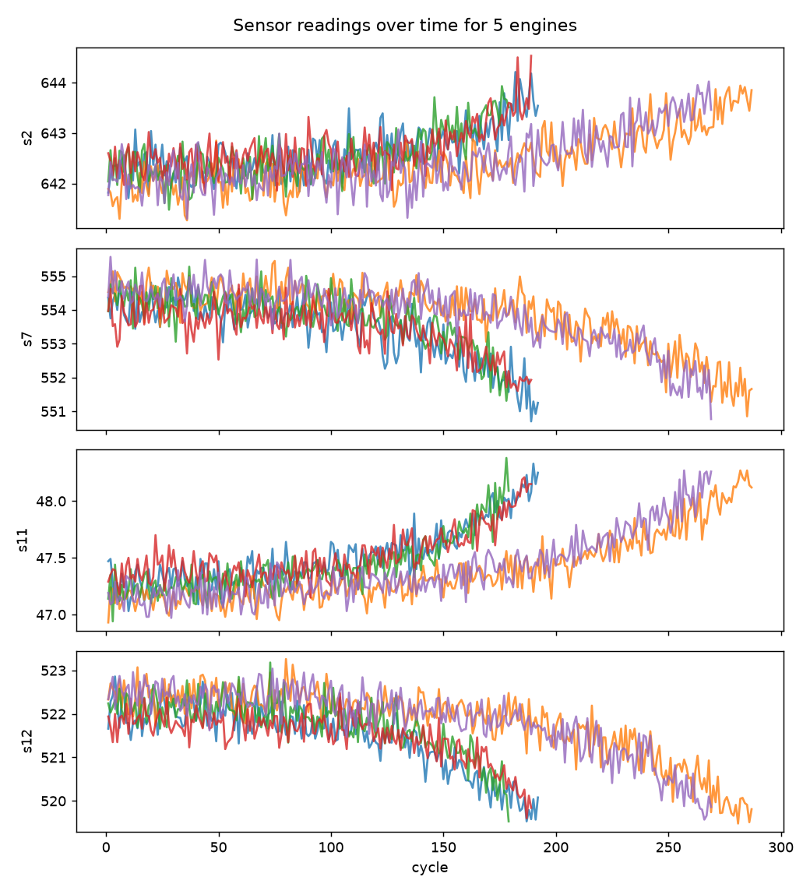
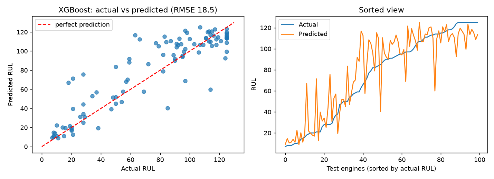
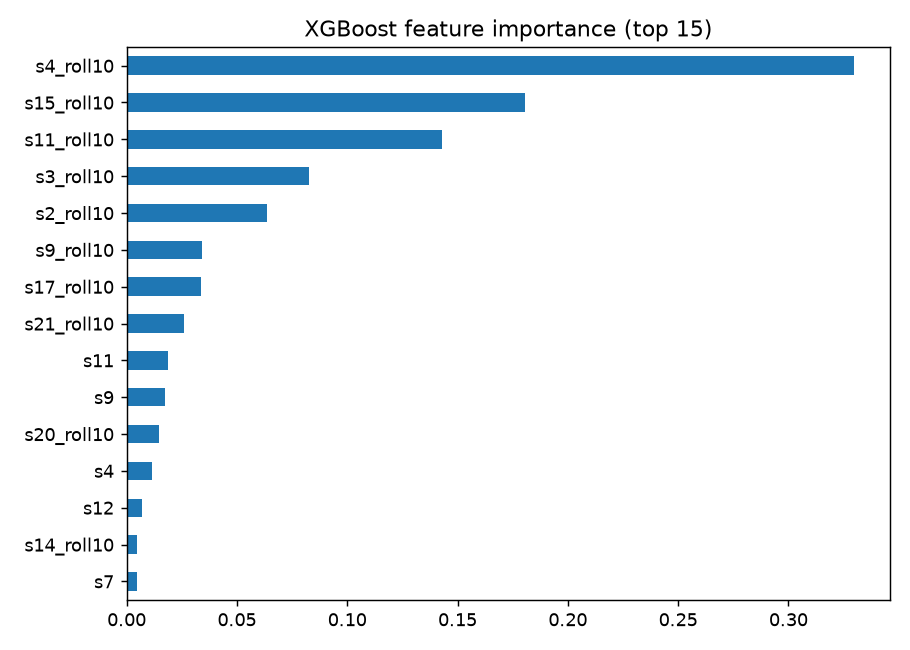

# Remaining Useful Life (RUL) Prediction of Jet Engines with XGBoost

Predicting how many flight cycles a turbofan engine has left before failure, using
sensor time series from the **NASA C-MAPSS (FD001)** dataset and **XGBoost**.

## Problem
Each of 100 training engines is run until it fails, with 21 sensors recorded every cycle.
For 100 test engines the recording stops at a random point, and the task is to predict the
**remaining useful life** at that point. Better predictions mean maintenance can be planned
before a failure instead of after it.

## Approach
1. **RUL label**: `max cycle of engine - current cycle`, capped at **125** (early in an engine's life, degradation is not yet visible in the sensors).
2. **Cleaning**: dropped 7 constant columns (`op3, s1, s5, s10, s16, s18, s19`), then MinMax-scaled the rest (scaler fit on train only).
3. **Features**: raw sensors + **10-cycle rolling mean** per engine (smooths noise, captures trend).
4. **Validation**: split by **engine ID** (80 / 20), never by row, to avoid leakage between cycles of the same engine.
5. **Models**: Linear Regression baseline vs XGBoost.
6. **Tuning**: manual grid over `max_depth`, `learning_rate`, `n_estimators` on the validation engines.
7. **Final evaluation**: retrain on all 100 training engines, predict from the last recorded cycle of each of the 100 test engines, score with **RMSE** against `RUL_FD001.txt`.

## Results
Evaluated on the 100 official test engines (prediction made at the last recorded cycle of each engine).

| Model | Test RMSE (cycles) |
|---|---|
| Linear Regression (baseline) | 20.81 |
| XGBoost (tuned) | **18.55** |

XGBoost is about **11% better** than the baseline.
Best hyperparameters (chosen on validation engines): `max_depth=3`, `learning_rate=0.05`, `n_estimators=200`.
Full tuning table: `outputs/tuning_results.csv`.

**Key observations**
- Predictions are most accurate when an engine is close to failure (low RUL), which is the most useful range for maintenance decisions.
- Mid-range predictions are noisier, and several engines are over-predicted.
- Rolling-mean features dominate the feature importance (7 of the top 8), and sensors `s4`, `s15` and `s11` matter most. Smoothing the noisy raw sensors helped.
- Shallow trees (`max_depth=3`) with a low learning rate generalised best, a sign that deeper models overfit this small dataset (100 engines).

### Plots




## Project structure
```
data/            train_FD001.txt, test_FD001.txt, RUL_FD001.txt
src/rul_xgboost.py   full pipeline
outputs/         plots and result tables
requirements.txt
```

## How to run
```bash
pip install -r requirements.txt
python src/rul_xgboost.py
```

## Limitations and next steps
- Only FD001 (one operating condition, one fault mode); FD002-FD004 are harder.
- Only one rolling window; lag features and multiple windows could help.
- No NASA asymmetric scoring function (late predictions are penalised more than early ones).
- Hyperparameters tuned by hand on a single validation split; Optuna or cross-validation by engine would be more robust.
- SHAP could give richer explanations than built-in feature importance.

## Data source
NASA Prognostics Center of Excellence, C-MAPSS turbofan engine degradation simulation.
Reference: A. Saxena et al., *Damage Propagation Modeling for Aircraft Engine Run-to-Failure Simulation*, PHM08.
